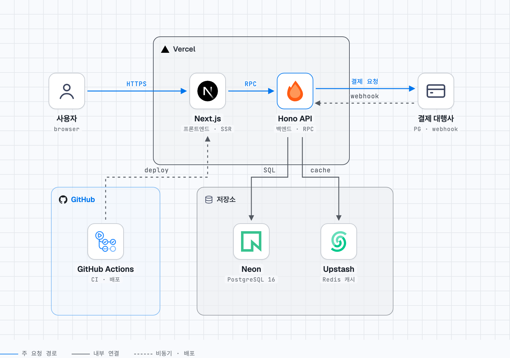
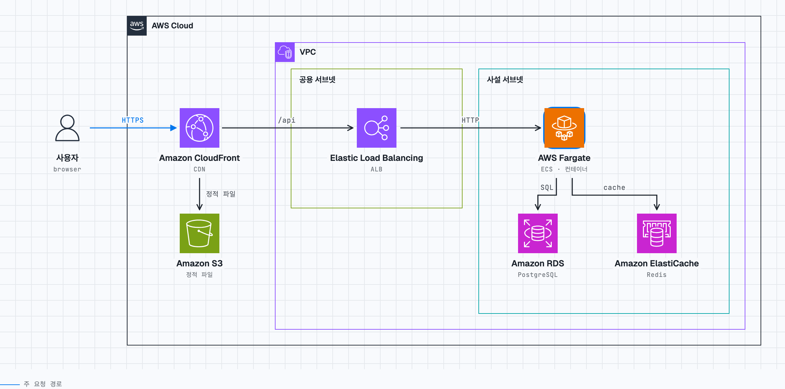

# arch-diagram

한 문장으로 스택을 설명하면, **읽기 좋은 아키텍처 다이어그램**이 나옵니다 — 공식 브랜드 로고, 그룹 박스, 텍스트를 절대 가로지르지 않는 직각 화살표, 범례, 그리고 어디서 열어도 똑같이 보이는 한글.

<picture>
  <source media="(prefers-color-scheme: dark)" srcset="docs/order-service-dark.png">
  
</picture>

> 주문 서비스 아키텍처 그려줘: Vercel 위에 Next.js와 Hono API, DB는 Neon, 캐시는 Upstash, 결제는 외부 PG로 나가고 GitHub Actions로 배포해.

<picture>
  <source media="(prefers-color-scheme: dark)" srcset="docs/aws-commerce-dark.png">
  
</picture>

> 커머스 서비스 AWS 구성도: CloudFront 뒤에 S3와 공용 서브넷의 ALB, 사설 서브넷에 Fargate·RDS·ElastiCache.

`arch-diagram`은 두 플러그인의 장점을 하나로 합친 것입니다.

| 가져온 것 | 출처 |
|---|---|
| 공식 로고 수집 체인(svgl → devicon → gilbarbara, AWS/GCP/Azure 공식 아이콘 패키지, Lucide 픽토그램), HTML 캔버스 + SVG 엣지 오버레이, 벤더별 작도 규칙(VPC/서브넷/리전), 라이트·다크 동시 렌더, PNG/TSX 내보내기 | [stack-diagram](https://github.com/caru-ini/stack-diagram) |
| "삭제가 최고의 수정" 철학, 복잡도 예산(노드 ≤ 9, 엣지 ≤ 12, 강조색 1경로), 6가지 커넥터 규칙(직각만, 라벨 간격, 선 겹침 금지, 접점 분산, 비끝점 통과 금지, 텍스트 통과 금지), 접근성 계약, 한글 폰트 게이트 | [diagram-design](https://github.com/cathrynlavery/diagram-design) + [korean-font 포크](https://github.com/janghoesoo1/diagram-design-korean-font) |
| **새로 추가:** 마크업만으로 위 규칙을 전부 검사하는 `check.py`, Pretendard 글리프 서브셋 임베딩(페이지당 ≈ 8 KB), 한글 폭 예산(음절당 1em)과 `wide` 노드, 한글 작명 규칙, `lang=ko` 자동 설정 | arch-diagram |

## 설치

**Claude Code**

```
/plugin marketplace add janghoesoo1/arch-diagram
/plugin install arch-diagram@arch-diagram
```

로컬 체크아웃에서: `/plugin marketplace add /path/to/arch-diagram` 후 동일하게 설치.

**Codex**

```
codex plugin marketplace add janghoesoo1/arch-diagram
codex plugin add arch-diagram@arch-diagram
```

**Factory Droid**

```
droid plugin marketplace add https://github.com/janghoesoo1/arch-diagram
droid plugin install arch-diagram@arch-diagram --scope user
```

**스킬만 (Cursor 등 agentskills 호환)**: `npx skills add janghoesoo1/arch-diagram`. Claude 앱에서는 [Releases](https://github.com/janghoesoo1/arch-diagram/releases)의 `arch-diagram.zip`을 스킬로 업로드.

### 요구 사항

- Python 3.9+, 로고 수집용 네트워크
- PNG: `pip install playwright && python3 -m playwright install --with-deps chromium`
- 한글 오프라인 임베딩: `pip install fonttools brotli` (없으면 Google Fonts의 Noto Sans KR을 링크)

`/arch-diagram:doctor`가 전부 점검해 줍니다.

## 명령

| 명령 | 역할 |
|---|---|
| `/arch-diagram:draw <설명> [--png] [--tsx] [--artifact]` | 내용 정리 → 아이콘 수집 → 배치 → 빌드 → 검사 → 렌더 → 전달 |
| `/arch-diagram:check <file.html>` | 가독성 게이트만 실행 |
| `/arch-diagram:export <file.html> [--png\|--tsx]` | 라이트/다크 PNG 쌍 또는 React 컴포넌트 |
| `/arch-diagram:doctor` | 환경 진단 |

명령 없이 "아키텍처 다이어그램 그려줘", "시스템 구성도", "우리 스택 그림으로", "draw our stack" 등으로 말해도 스킬이 뜹니다.

## 무엇이 달라지나

**가독성이 결과물입니다.** `scripts/check.py`는 빌드된 HTML을 읽어 다음을 실패 처리합니다: 캔버스 밖 요소, 겹치는 노드, 세 줄로 넘어가는 이름, 그룹 밖으로 삐져나온 노드, 대각선 엣지, 노드에 닿지 않는 엣지, 타일이나 **어떤 텍스트든** 관통하는 엣지, 같은 선을 공유하는 엣지, 12px 미만으로 붙은 접점, 선 위·타일 위·그룹 라벨 모서리의 라벨, 범례 누락, 한글이 있는데 한글 서체가 없는 경우. 예산 초과·격자 이탈·과밀은 경고합니다.

**한글이 1급 언어입니다.** 템플릿의 서체 스택은 `Geist → Pretendard → Noto Sans KR → Apple SD Gothic Neo → Malgun Gothic`이고, mono 스택에도 같은 한글 꼬리가 붙어 `프론트엔드 · SSR` 같은 역할 줄이 예측 가능하게 렌더됩니다. `build.py --kr-font auto`는 페이지에 쓰인 글자만 Pretendard에서 뽑아 임베드하므로 CI·아티팩트 샌드박스·오프라인에서도 동일합니다. 노드 폭은 음절당 1em으로 예산을 잡고(`wide`/`xwide`), 브랜드명은 라틴, 역할은 한글, 조사·동사 없는 명사구, 순서는 ①②③ — 규칙은 [`references/korean.md`](skills/arch-diagram/references/korean.md)에.

**로고는 진짜만.** 색을 바꾸거나 다시 그리지 않습니다. 흰 로고는 어두운 타일에, 개념은 Lucide 픽토그램으로, AWS/GCP/Azure는 각 벤더의 공식 아이콘과 작도 규칙으로. 토스·카카오·네이버 같은 국내 서비스 로고는 어떤 공개 소스에도 없으니 공식 에셋 URL을 지정하거나 역할 픽토그램을 씁니다.

**결과물은 HTML 한 파일.** 폰트·아이콘이 전부 data URI로 들어 있어 어디서나 열립니다. PNG(라이트+다크)는 그 HTML을 헤드리스 Chromium으로 찍은 것이고, TSX는 같은 좌표의 React 컴포넌트입니다.

## 저장소 구조

```
skills/arch-diagram/
  SKILL.md                 워크플로우·규칙 (< 40 KB)
  assets/template.html     캔버스 템플릿 — 마크업이 곧 포맷 문서
  assets/examples/         빌드된 예제 (+ src/ 초안)
  assets/fonts/ generic/   Geist·JetBrains Mono, 범용 픽토그램
  references/              geometry · icons · korean · style · tsx · export · doctor
  scripts/                 fetch_icons · build · check · render_png
commands/                  Claude Code 슬래시 명령
scripts/                   저장소 게이트 (test_check, verify_package)
docs/                      예제 PNG, ADR
```

## 의도적으로 뺀 것

diagram-design의 나머지 38개 다이어그램 타입, 브랜드 프로필 온보딩, Mermaid/draw.io 가져오기, 애니메이션, 그리고 stack-diagram의 공개 갤러리 공유. 이 플러그인은 아키텍처 다이어그램 하나를 잘 그리는 데 집중합니다 ([ADR 0001](docs/adr/0001-one-skill-from-two-lineages.md)).

## 라이선스

코드·문서 MIT (`LICENSE` — stack-diagram, diagram-design 저작권 고지 포함). 번들 폰트 SIL OFL 1.1. 로고는 번들하지 않고 빌드 시 수집하며 각 소유자의 상표입니다 — [`THIRD_PARTY_LICENSES.md`](THIRD_PARTY_LICENSES.md).
